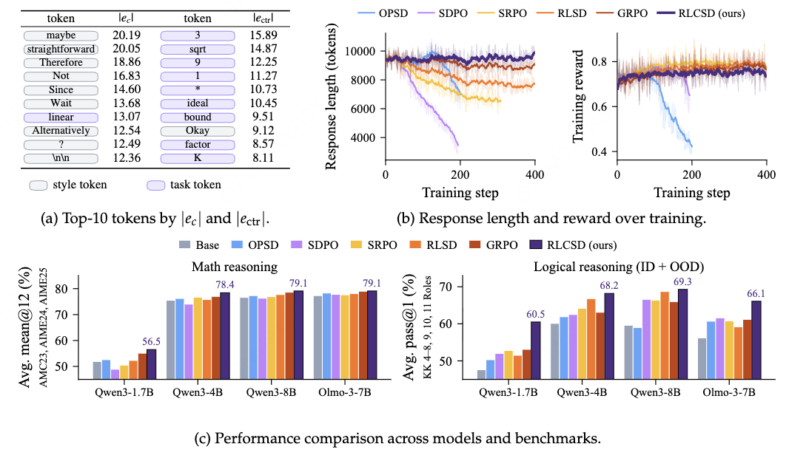
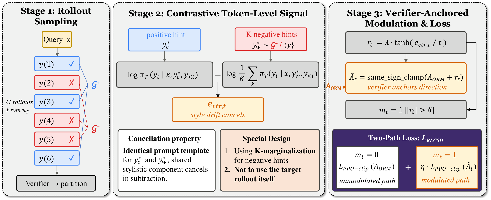
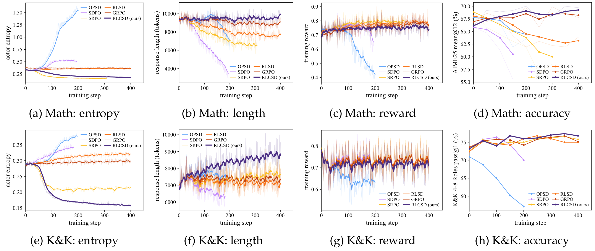
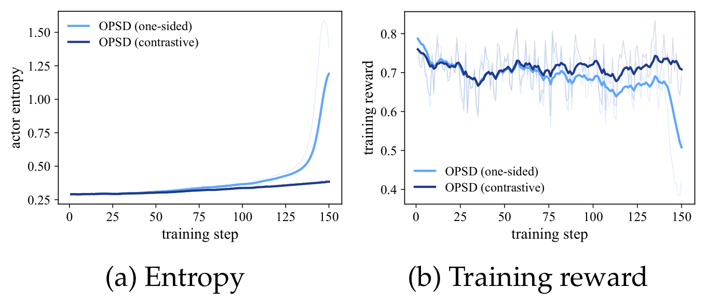
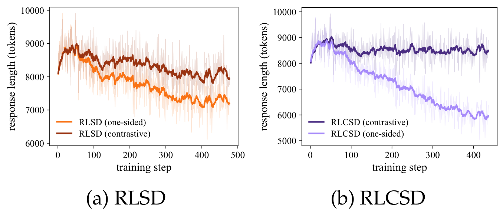

<div align="center">

# RLCSD: Reinforcement Learning with Contrastive On-Policy Self-Distillation

[](https://arxiv.org/abs/2606.11709)  [](https://huggingface.co/datasets/Leyiii/RLCSD)

</div>

## Introduction

On-policy self-distillation (OPSD) gives reasoning models dense, token-level
supervision by aligning the student's distribution with a teacher distribution
conditioned on privileged context, typically a verified solution. This context
can also favor shorter, more assertive phrasing and suppress exploratory
reasoning. We call this **privilege-induced style drift**: the resulting
signal concentrates on **style tokens** and dilutes supervision on
**task-bearing tokens**, contributing to premature response-length shrinkage
and, in some methods, training instability.

**RLCSD** contrasts the teacher–student gaps under a correct and an incorrect
reference solution, presented with the same prompt template. This suppresses
shared stylistic shifts and makes the remaining token-level signal more
focused on task correctness. RLCSD uses that signal to modulate the
verifier-derived GRPO advantage while preserving its update direction.

Across Qwen3 (1.7B / 4B / 8B) and Olmo-3-7B-Think, RLCSD achieves the highest
math and logic averages among the evaluated methods. Math training uses
DeepMath, with evaluation on AMC23, AIME24, and AIME25; logical reasoning
uses Knights & Knaves at both in-domain and harder out-of-domain role counts.

<p align="center">
  
</p>

Figure 1: (a) the largest one-sided and contrastive signals concentrate on
different token types; (b) RLCSD preserves response length and stable training
reward; (c) average math mean@12 and Knights & Knaves pass@1 across all four
model scales. The logic average includes both ID and OOD settings.

## Method overview

<p align="center">
  
</p>

Figure 3 illustrates the self-rollout option for the positive hint. **The main
experiments use dataset-provided ground-truth reasoning traces (GT CoT)** as
positive hints; incorrect student rollouts supply the negative hints. RLCSD's
teacher is initialized from the same pretrained checkpoint as the student and
**kept fixed throughout training**.

For each query we run three stages:

1. **Rollout sampling and outcome evaluation.** Sample G student rollouts,
   score them with a binary rule-based verifier, and partition them into
   correct (𝒢⁺) and incorrect (𝒢⁻) subsets. The verifier outcomes provide
   the group-relative advantage A<sub>ORM</sub>.
2. **Contrastive token-level signal.** Pair a correct reference y\*<sub>c</sub>
   with K incorrect student rollouts y\*<sub>w,k</sub> from the same query.
   Both branches use an identical reference-solution template, including the
   reasoning trace and final answer. Compute

   ```
   p_c,t   = π_T(y_t | x, y*_c, y_<t)
   p_w,k,t = π_T(y_t | x, y*_{w,k}, y_<t)
   e_ctr,t = log(p_c,t) − log((1/K) Σ_{k=1}^K p_w,k,t)
   ```

   **Average negative-hint probabilities before taking the logarithm** to
   reduce sensitivity to individual error types. **Exclude the target
   rollout from every rollout-derived hint pool**: negatives come from
   𝒢⁻ ∖ {y}; optional self-rollout positives come from 𝒢⁺ ∖ {y}.
3. **Verifier-anchored modulation and two-path loss.** Set
   r<sub>t</sub> = λ tanh(e<sub>ctr,t</sub> / τ) and select tokens with
   |r<sub>t</sub>| > δ. Add the modulation to A<sub>ORM</sub> and clamp at
   zero to prevent a reversal of the verifier's update direction. Within
   each rollout, independently average the PPO clipped objective over the
   unmodulated and modulated token sets, weighting the latter by η; omit
   an empty path. Average across rollouts and queries, and minimize the
   negative of this objective. Independent normalization prevents the
   selected tokens (roughly 20%–30%) from being diluted by the other tokens.

See Sections 3.3–3.6 for the construction and loss, Section 4.4 for component
ablations, and Appendix F for hyperparameter sensitivity. The paper uses
**K = 4, τ = 1.3, λ = 0.5, δ = 0.02, and η = 0.5**.

## Methods supported in this repo

Each YAML config selects a method via the `method:` key. Implementations live in
`third_party/verl/verl/trainer/ppo/core_algos.py` (loss) and
`src/self_distill_main.py` (RLCSD/ECTR rollout-side data path).

| Key          | Method                                                                                   | Reference                                                                  |
|--------------|------------------------------------------------------------------------------------------|----------------------------------------------------------------------------|
| `grpo`       | Group Relative Policy Optimization — verifier-only RLVR baseline.                        | Shao et al., 2024 — [arXiv:2402.03300](https://arxiv.org/abs/2402.03300)   |
| `opsd`       | On-policy self-distillation with dense forward-KL distillation and per-token KL clipping. | Zhao et al., 2026 — [arXiv:2601.18734](https://arxiv.org/abs/2601.18734) |
| `sdpo`       | Dense distillation using Jensen–Shannon divergence (mode-balancing variant of OPSD).     | Hübotter et al., 2026 — [arXiv:2601.20802](https://arxiv.org/abs/2601.20802) |
| `srpo`       | Sample-level routing: GRPO on correct rollouts, SDPO-style distillation on failed ones.  | Li et al., 2026 — [arXiv:2604.02288](https://arxiv.org/abs/2604.02288)     |
| `rlsd`       | Per-token sampled-token distillation gap used to *modulate* A<sub>ORM</sub>.             | Yang et al., 2026 — [arXiv:2604.03128](https://arxiv.org/abs/2604.03128)   |
| `rlcsd`      | **This work** — contrastive cancellation across symmetric positive/negative hints, then K-marginalized and integrated as a verifier-anchored A<sub>ORM</sub> modulation. | this repo                                                                  |
| `opsd_ectr`  | OPSD + the contrastive construction grafted onto its dense distillation target (plug-in study, §4.3 of the paper). | this repo                                                                  |
| `rlsd_ectr`  | RLSD + the contrastive construction grafted onto its scalar modulation (plug-in study, §4.3 of the paper). | this repo                                                                  |

The two `_ectr` variants are **not new training methods on their own**; they
exist to show that the contrastive principle behind RLCSD is general — see
[Contrastive hints as a plug-in component](#contrastive-hints-as-a-plug-in-component)
below.

## Repo layout

```
src/
  self_distill_main.py     RLCSD / OPSD / SDPO / RLSD / SRPO trainer entry
  verl_main.py             Legacy non-verl trainer (kept for reference)
  losses.py                generalized_jsd_loss / sdpo_loss / rlsd_loss
  verl_reward.py           Custom reward function used by verl
  opsd_format.py           Prompt template + privileged-context wrapping
  data_utils.py / prompts.py / models.py
configs/
  math_deepmath/           {model}_{algo}.yaml  (4 models × 6 algos + 4B-only ectr)
  logic_kk/                same layout
scripts/
  _run_verl.sh             Launcher: reads a YAML and runs the right entry
  math_deepmath/run_*.sh   Per-config shims
  logic_kk/run_*.sh
  download_data.py         Pull train/eval parquets from HuggingFace
third_party/verl/          Vendored verl with the RLCSD policy losses registered
assets/                    Figures from the paper used in this README
requirements.txt
```

## Install

```bash
# Recommended: a fresh Python 3.10–3.12 env
pip install -r requirements.txt
```

A few practical notes:

- `requirements.txt` pins `torch>=2.5.0,<2.10` to keep a CUDA 12 toolchain.
  torch 2.10+ defaults to CUDA 13 wheels which require a newer NVIDIA driver
  than CUDA 12.x systems ship. For an explicit CUDA match install from the
  PyTorch index:
  ```bash
  pip install "torch>=2.5.0,<2.10" --index-url https://download.pytorch.org/whl/cu126
  ```
- `flash-attn` builds against the installed torch — use
  `pip install flash-attn --no-build-isolation` if pip's build env can't find torch.
- `third_party/verl/` is added to `PYTHONPATH` automatically by `_run_verl.sh`.

## Data

Training and eval parquets live at
[Leyiii/RLCSD](https://huggingface.co/datasets/Leyiii/RLCSD). Pull everything
in one shot:

```bash
python scripts/download_data.py --all
```

This writes to `data/verl/<dataset>/{train,val}.parquet`. The launcher resolves
paths under that root.

| Dataset                              | Used by                            |
|--------------------------------------|------------------------------------|
| `deepmath_filtered_level5_7`         | Qwen3-1.7B (math train)            |
| `deepmath_filtered_level6_8`         | Qwen3-4B (math train)              |
| `deepmath_filtered_level7_10`        | Qwen3-8B + Olmo3-7B (math train)   |
| `amc23+aime24+aime25`                | math eval                          |
| `kk_4to8`                            | logic train (Knights & Knaves 4–8) |
| `kk_4to8_test+kk_9+kk_10+kk_11`      | logic eval (ID 4–8 + OOD 9–11)     |

Training data subsets come from filtering
[DeepMath-103K](https://huggingface.co/datasets/zwhe99/DeepMath-103K)
([He et al., 2025](https://arxiv.org/abs/2504.11456)) by difficulty band.
The Knights & Knaves generator follows
[Logic-RL](https://arxiv.org/abs/2502.14768) (Xie et al., 2025).

## Run

```bash
# RLCSD on Qwen3-4B, math reasoning
bash scripts/math_deepmath/run_qwen3_4b_rlcsd.sh

# SDPO baseline on Olmo3-7B-Think, logic puzzles
bash scripts/logic_kk/run_olmo3_7b_think_sdpo.sh
```

Each shim is a one-liner that forwards a config to `scripts/_run_verl.sh`. To
override individual hyperparameters, append Hydra-style overrides:

```bash
bash scripts/math_deepmath/run_qwen3_4b_rlcsd.sh learning_rate=2e-6 group_size=16
```

The shipped RLCSD configs use `correct_privileged_hint_source=gt_cot` and
`teacher_mode=fixed`, matching the paper's main setup. The correct branch uses
the dataset's ground-truth `extra_info.solution`; the wrong branch uses
incorrect sibling rollouts and excludes the target itself.

To opt into a verified sibling rollout for the correct branch, override the
hint source:

```bash
bash scripts/math_deepmath/run_qwen3_4b_rlcsd.sh correct_privileged_hint_source=self_rollout
```

Common environment overrides:

- `SWANLAB_API_KEY` — for swanlab logging (set `use_swanlab: true` in configs)
- `HF_ENDPOINT` — e.g. `https://hf-mirror.com` for a HuggingFace mirror
- `CUDA_HOME` — defaults to `/usr/local/cuda-12.6`

### Training logic updates

The Math/Logic training updates use GT CoT by default for RLCSD. Self-rollout
remains an opt-in implementation capability, without dedicated RLCSD self-rollout
YAML configurations or launch scripts. Environment integrations and cluster
operations are excluded.

## Results

### Experimental setup

The paper uses full-parameter training on **8 H20 GPUs**, a learning rate of
**1 × 10⁻⁶**, and thinking mode during training and evaluation. The generation
budgets are **16,384 tokens for training** and **38,912 for validation**.
All OPSD baselines and RLCSD use **GT CoT** as the correct privileged context;
RLCSD additionally uses incorrect student rollouts and keeps its teacher fixed
(Section 4.1 and Appendix B).

### Main results across model scales

Table 1 reports one RLCSD row per model.
RLCSD achieves the highest math and logic averages across all four model
blocks. Its gains over the Base model are **+4.6 / +12.9** (math / logic)
at 1.7B, **+2.9 / +8.1** at 4B, **+2.5 / +9.7** at 8B, and **+1.8 / +9.9**
on Olmo-3-7B.

| Model | Method | AMC23 | AIME24 | AIME25 | Math Avg. | KK 4–8 | KK 9 | KK 10 | KK 11 | Logic Avg. |
|-------|--------|------:|-------:|-------:|----------:|-------:|-----:|------:|------:|-----------:|
| Qwen3-1.7B | Base | 74.1 | 48.3 | 33.3 | 51.9 | 63.2 | 53.0 | 43.0 | 31.0 | 47.6 |
|  | GRPO | <u>76.6</u> | <u>51.6</u> | <u>37.2</u> | <u>55.1</u> | 67.4 | <u>59.0</u> | 52.0 | 34.0 | <u>53.1</u> |
|  | OPSD | 74.6 | 47.2 | 36.1 | 52.6 | 62.0 | <u>59.0</u> | 51.0 | 29.0 | 50.3 |
|  | SDPO | 73.0 | 42.2 | 31.4 | 48.9 | 63.8 | 56.0 | 52.0 | <u>36.0</u> | 52.0 |
|  | SRPO | 72.6 | 45.6 | 33.3 | 50.5 | 63.0 | <u>59.0</u> | <u>54.0</u> | 35.0 | 52.8 |
|  | RLSD | 73.9 | 46.1 | 36.9 | 52.3 | <u>68.0</u> | 57.0 | 49.0 | 32.0 | 51.5 |
|  | **RLCSD** | **78.2** | **53.1** | **38.3** | **56.5** (+4.6) | **71.8** | **66.0** | **61.0** | **43.0** | **60.5** (+12.9) |
| Qwen3-4B | Base | 88.6 | 72.5 | 65.3 | 75.5 | 73.2 | 67.0 | 58.0 | 42.0 | 60.1 |
|  | GRPO | 89.1 | <u>75.8</u> | 66.1 | <u>77.0</u> | 75.4 | 71.0 | 61.0 | 45.0 | 63.1 |
|  | OPSD | <u>89.4</u> | 73.3 | 65.8 | 76.2 | 73.4 | 71.0 | 61.0 | 42.0 | 61.9 |
|  | SDPO | 88.2 | 70.3 | 63.6 | 74.0 | 75.8 | 71.0 | 60.0 | 43.0 | 62.5 |
|  | SRPO | 89.2 | 74.2 | <u>66.7</u> | 76.7 | 74.6 | **76.0** | 59.0 | 47.0 | 64.2 |
|  | RLSD | 88.9 | 72.5 | 66.1 | 75.8 | <u>76.0</u> | <u>75.0</u> | <u>67.0</u> | <u>49.0</u> | <u>66.8</u> |
|  | **RLCSD** | **90.8** | **76.4** | **68.1** | **78.4** (+2.9) | **77.6** | **76.0** | **68.0** | **51.0** | **68.2** (+8.1) |
| Qwen3-8B | Base | 88.8 | 74.2 | 66.9 | 76.6 | 72.4 | 67.0 | 55.0 | 44.0 | 59.6 |
|  | GRPO | <u>90.1</u> | <u>76.1</u> | <u>69.7</u> | <u>78.6</u> | <u>76.8</u> | 75.0 | 63.0 | 49.0 | 66.0 |
|  | OPSD | 90.0 | 74.7 | 67.2 | 77.3 | 68.8 | 65.0 | 56.0 | 46.0 | 59.0 |
|  | SDPO | <u>90.1</u> | 74.2 | 64.7 | 76.3 | 76.4 | <u>78.0</u> | <u>66.0</u> | 46.0 | 66.6 |
|  | SRPO | 89.4 | 75.6 | 65.8 | 76.9 | 76.6 | 76.0 | 63.0 | 50.0 | 66.4 |
|  | RLSD | 89.6 | 75.6 | 67.8 | 77.7 | <u>76.8</u> | **79.0** | **67.0** | <u>52.0</u> | <u>68.7</u> |
|  | **RLCSD** | **91.0** | **76.4** | **70.0** | **79.1** (+2.5) | **78.2** | **79.0** | <u>66.0</u> | **54.0** | **69.3** (+9.7) |
| Olmo-3-7B | Base | 91.2 | 73.9 | 66.9 | 77.3 | 70.6 | 64.0 | 55.0 | 35.0 | 56.2 |
|  | GRPO | 92.4 | <u>75.8</u> | **68.9** | <u>79.0</u> | <u>73.8</u> | 69.0 | <u>63.0</u> | 39.0 | 61.2 |
|  | OPSD | 92.3 | 75.4 | 67.1 | 78.3 | 72.6 | <u>70.0</u> | 61.0 | 39.0 | 60.7 |
|  | SDPO | 91.8 | 74.3 | 67.2 | 77.8 | 73.4 | 68.0 | 60.0 | <u>45.0</u> | <u>61.6</u> |
|  | SRPO | 91.9 | 75.2 | 65.6 | 77.6 | 73.0 | 67.0 | 62.0 | 41.0 | 60.8 |
|  | RLSD | <u>92.5</u> | 74.9 | 66.8 | 78.1 | 73.6 | 66.0 | 60.0 | 37.0 | 59.2 |
|  | **RLCSD** | **92.7** | **76.1** | <u>68.6</u> | **79.1** (+1.8) | **75.4** | **76.0** | **65.0** | **48.0** | **66.1** (+9.9) |

Math is reported as **mean@12**; Knights & Knaves as **pass@1**. KK 4–8 is the
in-domain (ID) test set; 9 / 10 / 11 are out-of-domain (OOD) role counts.
**Bold** marks the best result in each model block, including ties, and
<u>underline</u> marks the second-highest result. Parentheses in RLCSD's
average columns show gains over the Base model. RLCSD leads both task-family
averages for every model, while RLSD scores higher on Qwen3-8B KK 10 and GRPO
scores higher on Olmo-3-7B AIME25.

### Training stability

Figure 5 compares **Qwen3-8B** training on math (top) and Knights & Knaves
(bottom), showing actor entropy, response length, training reward, and
validation performance.

- **Math:** OPSD, SDPO, SRPO, and RLSD show declining response lengths and
  limited or deteriorating later-stage validation performance. OPSD and
  SDPO also exhibit rising entropy and sharp reward drops.
- **Logic:** length shrinkage is most evident for SDPO; other baselines
  generally plateau at shorter lengths than RLCSD. OPSD and SDPO show
  increasing entropy and declining validation accuracy, with a sustained
  training-reward drop for OPSD.
- **RLCSD:** training remains stable, response length is preserved on math
  and gradually increases on logic, and validation performance remains
  strong. The validation panels report **AIME25 mean@12** and **KK 4–8
  pass@1**, respectively.

<p align="center">
  
</p>

### Contrastive hints as a plug-in component

Table 2 compares two
privileged-context constructions for OPSD, RLSD, and RLCSD on Qwen3-4B,
with each method's underlying optimization held fixed:

1. **One-sided** — use the dataset-provided GT CoT as the correct privileged
   context.
2. **Contrastive** — retain the same GT CoT positive context and additionally
   use incorrect student rollouts for the same query.

Δ is the gain of the contrastive construction over its one-sided counterpart.
Contrastive contexts improve the math and logic averages for all three
methods, with no decreases on the individual benchmarks reported here.
The math / logic average gains are **+1.0 / +0.9** for OPSD,
**+1.4 / +0.1** for RLSD, and **+3.6 / +6.7** for RLCSD.

| Method | Context construction | AMC23 | AIME24 | AIME25 | Math Avg. | KK 4–8 | KK 9 | KK 10 | KK 11 | Logic Avg. |
|--------|----------------------|------:|-------:|-------:|----------:|-------:|-----:|------:|------:|-----------:|
| OPSD | One-sided | 89.4 | 73.3 | 65.8 | 76.2 | 73.4 | **71.0** | **61.0** | 42.0 | 61.9 |
|  | Contrastive | **89.6** | **75.6** | **66.4** | **77.2** | **74.2** | **71.0** | **61.0** | **45.0** | **62.8** |
|  | Δ | +0.2 | +2.3 | +0.6 | +1.0 | +0.8 | 0.0 | 0.0 | +3.0 | +0.9 |
| RLSD | One-sided | 88.9 | 72.5 | 66.1 | 75.8 | 76.0 | **75.0** | **67.0** | **49.0** | 66.8 |
|  | Contrastive | **89.8** | **75.3** | **66.4** | **77.2** | **76.4** | **75.0** | **67.0** | **49.0** | **66.9** |
|  | Δ | +0.9 | +2.8 | +0.3 | +1.4 | +0.4 | 0.0 | 0.0 | 0.0 | +0.1 |
| RLCSD | One-sided | 88.9 | 73.1 | 62.5 | 74.8 | 73.8 | 71.0 | 58.0 | 43.0 | 61.5 |
|  | Contrastive | **90.8** | **76.4** | **68.1** | **78.4** | **77.6** | **76.0** | **68.0** | **51.0** | **68.2** |
|  | Δ | +1.9 | +3.3 | +5.6 | +3.6 | +3.8 | +5.0 | +10.0 | +8.0 | +6.7 |

Math is reported as **mean@12** and Knights & Knaves as **pass@1**, with
KK 4–8 as ID and KK 9–11 as OOD. **Bold** marks the best result within each
method block, including ties.

**`opsd_ectr` — contrast at the distribution level.** OPSD uses a guided
teacher target `softmax((1 + α) ℓ_c − α ℓ_w)`, where ℓ<sub>c</sub> and
ℓ<sub>w</sub> are teacher logits under the correct and incorrect hints.
A soft mask based on the KL divergence between these distributions gates
the per-token distillation loss (Equations 18–19). Figure 6 shows **Qwen3-4B
on Knights & Knaves**: adding contrast curbs entropy growth and stabilizes
training reward.

<p align="center">
  
</p>

**`rlsd_ectr` — contrast at the scalar modulation level.** The contrastive
signal replaces the one-sided teacher–student gap used to modulate
A<sub>ORM</sub>. Figure 7 shows **Qwen3-4B on math**: contrast mitigates
premature response-length shrinkage for RLSD (left) and RLCSD (right).
The right panel compares full RLCSD with its one-sided ablation.

<p align="center">
  
</p>

These plug-in results are reported only on Qwen3-4B in the paper, and only
those configs ship here (`configs/{math_deepmath,logic_kk}/qwen3_4b_opsd_ectr.yaml`
and `qwen3_4b_rlsd_ectr.yaml`).

### Component ablations and broader analysis

On Qwen3-4B, every component removal in Table 3 reduces both task-family
averages. Removing K-marginalization lowers math / logic averages by
**1.6 / 3.8 points**; allowing the target rollout into the hint pool lowers
them by **1.6 / 4.5 points**. Removing verifier anchoring causes the largest
drop (**2.7 / 5.8 points**), while replacing the two-path loss with a single
global average costs **2.0 / 4.8 points**.

Section 4.5 extends the task-versus-style analysis to cross-model on-policy
distillation. Its teacher comparison suggests that a stronger standalone
teacher can produce a weaker distilled student when the learning signal is
dominated by stylistic differences. Per-token KL rankings offer a diagnostic
for teacher selection; the paper does not directly apply RLCSD's hint-based
contrast to this setting.

## Built on verl

The vendored fork under `third_party/verl/` is based on
[verl](https://github.com/volcengine/verl) ([Sheng et al., 2024](https://arxiv.org/abs/2409.19256)).
RLCSD-specific extensions live in:

- `third_party/verl/verl/trainer/ppo/core_algos.py` — new policy losses
  registered via `@register_policy_loss("rlcsd" | "opsd_ectr" | "rlsd_ectr")`
- `third_party/verl/verl/workers/{actor,utils}/` — minor plumbing for the
  positive/negative teacher batches required by the RLCSD data path

## Citation

If you use this code or the released RLCSD method, please cite:

```bibtex
@article{pan2026rlcsd,
  title={RLCSD: Reinforcement Learning with Contrastive On-Policy Self-Distillation},
  author={Pan, Leyi and Tao, Shuchang and Zhai, Yunpeng and Zhang, Lingzhe and Liu, Zhaoyang and Ding, Bolin and Liu, Aiwei and Wen, Lijie},
  journal={arXiv preprint arXiv:2606.11709},
  year={2026}
}
```
